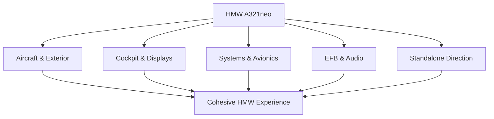
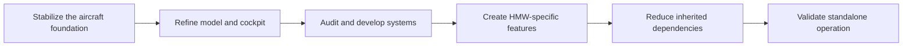
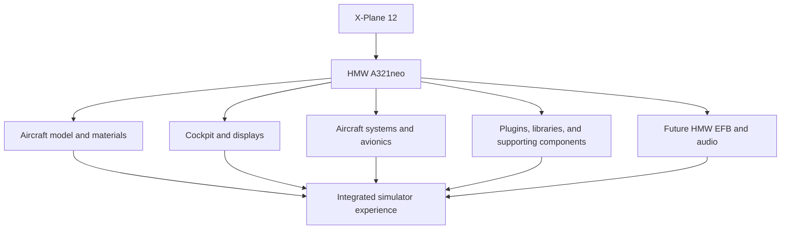

✈️ HoldMyWire A321neo
A community-driven Airbus A321neo project for X-Plane 12
A distinctive aircraft experience. An evolving cockpit and systems suite. A long-term ambition to build toward a standalone HMW aircraft.

HoldMyWire A321neo is an aircraft development project focused on bringing the Airbus A321neo to X-Plane 12 under the HoldMyWire identity. The project brings together aircraft modelling, cockpit development, systems integration, and a broader vision for an increasingly independent aircraft experience.

Our ambition goes beyond a visual reskin. The long-term direction is to develop HMW-specific assets and implementations progressively, while carefully evaluating existing components and preserving functionality as the aircraft evolves.
Project vision: Build an A321neo experience that feels cohesive, purposeful, and unmistakably HoldMyWire.

✈️ The vision
The A321neo is a versatile member of the A320 family, and this project aims to create a compelling simulator experience around it.

HMW A321neo is being developed around several connected areas:
- Aircraft identity — a distinct project with its own visual direction and presentation.
- Exterior and modelling — refine the aircraft's appearance and the details that bring it to life.
- Cockpit — develop cockpit geometry, presentation, and textures.
- Aircraft systems — integrate and progressively develop the systems needed for the intended simulation experience.
- HMW EFB — work toward an original Electronic Flight Bag tailored to the project.
- Audio — build toward a coherent sound experience.
- Independence — progressively reduce reliance on inherited components as suitable HMW implementations become available.
🧭 Development pillars

These pillars are connected: the goal is not simply to assemble individual features, but to bring them together into one cohesive aircraft.
🛠️ What we're building toward
Aircraft and exterior
The aircraft model and exterior presentation are central to the project. Development aims to refine the aircraft's visual identity and ensure that the model, materials, and presentation work together.
Cockpit and displays
Cockpit development focuses on visual refinement, geometry, and texturing, with the aim of creating a coherent environment for operating the aircraft in the simulator.
Systems and avionics
Aircraft systems are a major part of the intended experience. Existing implementations and dependencies are evaluated as development progresses, with future work guided by functionality, compatibility, and the overall direction of the project.
HMW Electronic Flight Bag
An original HMW EFB is part of the long-term vision. The aim is to create a project-specific interface rather than relying indefinitely on an inherited implementation.
Audio
Sound contributes significantly to immersion. The project aims to develop an audio experience that fits the aircraft and its HMW identity.
🛫 Roadmap at a glance
The following diagram illustrates the broad development direction, not a dated schedule or a claim that every stage is complete.

The work is incremental. Existing components may remain part of the project while replacements are designed, implemented, and tested. The standalone goal is a direction for development, not a claim that the aircraft is already fully independent.
🧩 The standalone ambition
HMW A321neo is intended to grow beyond a simple visual modification of an inherited aircraft foundation.

Progress toward that goal includes:
1. Understanding which assets, scripts, plugins, and systems the aircraft currently relies on.
2. Determining which dependencies are necessary and which can be replaced.
3. Developing original HMW assets and implementations where practical.
4. Testing changes carefully so that new work does not unintentionally break existing functionality.
5. Validating the aircraft's dependency requirements before describing it as standalone.
This approach prioritizes deliberate development over replacing components blindly. Independence is something to establish through implementation and testing—not just a label.
🗺️ How the pieces fit together

The exact components and dependencies may vary by build. This is a conceptual overview of the project's intended structure, not a definitive technical dependency map.
🤝 Community
Community feedback can help identify visual issues, usability improvements, compatibility concerns, and opportunities for future development.

If you follow or contribute to the project, constructive feedback is welcome. When proposing changes or submitting assets:
- Explain what the change improves.
- Include relevant screenshots or reproducible details when reporting issues.
- Document new dependencies and installation requirements.
- Preserve existing functionality unless a change is intentional.
- Confirm asset permissions and licensing before including third-party material.
📸 Screenshots and media
Screenshots of the aircraft, exterior, cockpit, and other features can be added here as representative images become available. Images should reflect the actual project and should not imply that unfinished features are already operational.
<!-- Add images when ready, for example:

-->

🎮 Simulator and compatibility
HMW A321neo is intended for X-Plane 12. Compatibility and functionality may depend on the particular build and its required assets, plugins, and libraries.

Please follow the installation instructions and dependency notes supplied with the version you use. No claim of complete standalone operation or feature parity is made here.
📄 Credits and licensing
Third-party assets, plugins, libraries, and other components may be subject to their own licenses and attribution requirements. Check the accompanying notices before using, modifying, or redistributing project files.

The fact that an asset has been modified does not automatically grant permission to redistribute it. Licensing and attribution should be respected as the project evolves.
🌟 The goal
A distinctive HMW A321neo for X-Plane 12—developed step by step, with a long-term commitment to building toward a standalone aircraft experience.

Thanks for taking an interest in HoldMyWire A321neo.